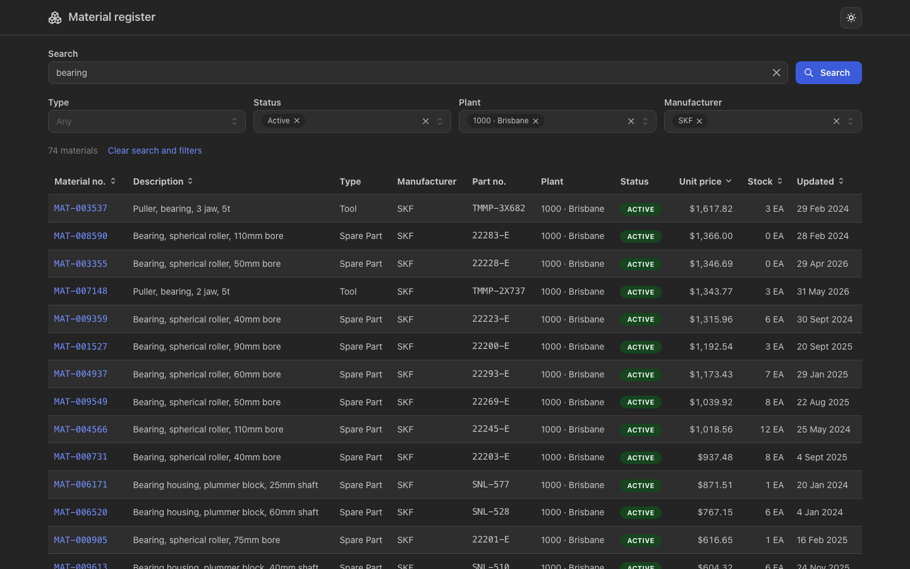
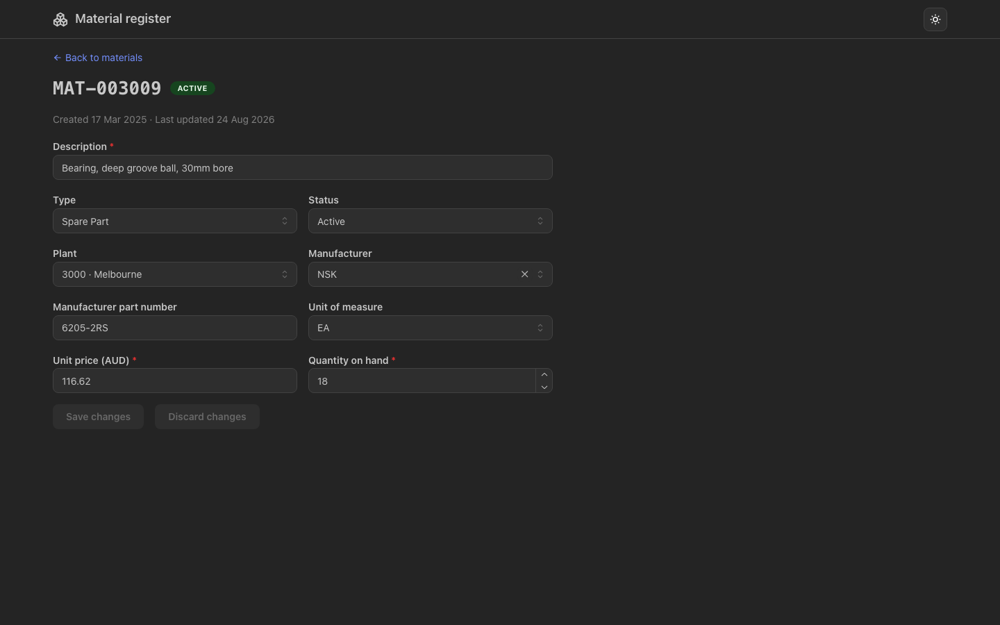
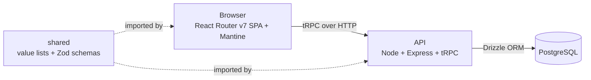
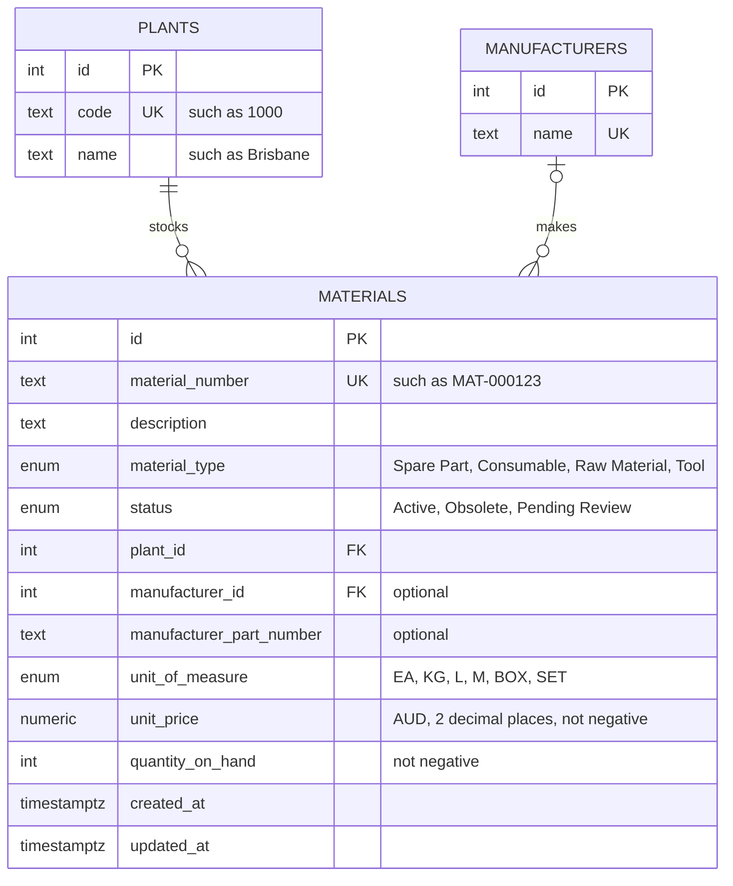

# Material Register

[](https://github.com/wasif-danesh/material-register/actions/workflows/ci.yml)

A web app for finding material records (spare parts, consumables, raw materials and
tools) in a large catalogue. It shows them in a table with search, filters, sorting and
pagination, all done in the database.

**Live demo:** https://material-register-web.onrender.com

The demo runs on Render's free plan, which puts an idle API to sleep. A scheduled request
to its health check every 10 minutes keeps it awake. Running it locally (below) is still
the main way to try it.



## Contents

- [Setup](#setup)
- [What it does](#what-it-does)
- [Architecture](#architecture)
- [Decisions and trade-offs](#decisions-and-trade-offs)
- [Search performance](#search-performance)
- [Engineering practices](#engineering-practices)
- [Tests and CI](#tests-and-ci)
- [Deployment](#deployment)
- [What I'd do next](#what-id-do-next)
- [How I used AI tools](#how-i-used-ai-tools)

## Setup

You need **Node 24** and **Docker**.

```bash
git clone https://github.com/wasif-danesh/material-register.git
cd material-register
cp .env.example .env
npm install
npm run db:up
npm run db:migrate
npm run db:seed
npm run dev
```

Then open http://localhost:5173. The API runs on http://localhost:3001.

A good first link is the example from the brief, "all active bearings from SKF stocked
at the Brisbane plant", which returns 74 materials:

http://localhost:5173/?q=bearing&status=Active&plant=1&mfr=67

| Command              | What it does                                                     |
| -------------------- | ---------------------------------------------------------------- |
| `npm run db:up`      | Starts Postgres in Docker and waits until it is ready            |
| `npm run db:migrate` | Applies the database migrations                                  |
| `npm run db:seed`    | Replaces all data with 10,000 materials, the same ones every run |
| `npm run dev`        | Starts the API and the web app with reload on change             |
| `npm test`           | Runs the API tests against a separate test database              |
| `npm run lint`       | ESLint                                                           |
| `npm run typecheck`  | TypeScript, in all three workspaces                              |
| `npm run format`     | Prettier                                                         |
| `npm run build`      | Production build of the web app                                  |
| `npm run db:down`    | Stops Postgres                                                   |

Port 5432, 3001 or 5173 already in use? Stop whatever is using it first; the ports are
fixed so that the setup needs no configuration.

## What it does

**Core functionality from the brief**

- **Table:** ten columns, including the related plant and manufacturer.
- **Pagination on the server:** page sizes of 10, 25, 50 and 100, with a total count.
- **Sorting:** five columns (material number, description, unit price, stock, last
  updated), in both directions.
- **Search:** one box that matches material number, description and manufacturer part
  number, ignoring case. It runs on the Search button or the Enter key, so it never
  sends a request per keystroke.
- **Filters:** type, status, plant and manufacturer. Each takes several values, they
  combine with each other and with the search, and one link clears them all.
- **API:** search, filtering, sorting and pagination all happen in SQL. Every input is
  validated with Zod.
- **States:** loading (skeleton rows, then faded rows while a new page loads), empty,
  error with a Retry button, and "page past the end".
- **URL state:** search, filters, sort, page and page size live in the URL, so a view
  can be refreshed, bookmarked or shared.

**Optional extras**

The brief says to pick one at most. I did three, on purpose: I wanted to build the whole
thing properly and I accepted going past the suggested time to do it. The core was
finished and checked before any extra was started, and each extra is separate from the
others.

- **Detail view:** click a row to view and edit a material, with validation in the
  browser and again on the server.
- **Tests:** 47 tests for the list query, the update and the input validation.
- **Faster search:** trigram indexes, with before and after measurements.

I did not build the natural-language filter; [What I'd do next](#what-id-do-next)
describes how I would.



## Architecture



One repository with three npm workspaces:

| Folder    | Contents                                                                 |
| --------- | ------------------------------------------------------------------------ |
| `shared/` | The fixed value lists and the Zod schemas. No server code                |
| `api/`    | Express, the tRPC router, the Drizzle schema, migrations, seed and tests |
| `web/`    | The React Router app                                                     |

**How a search travels through the code**

1. [`web/app/materials/tableState.ts`](web/app/materials/tableState.ts) reads the URL
   into the list input, using the shared schema.
2. [`web/app/routes/materials.tsx`](web/app/routes/materials.tsx) passes that input to
   the `materials.list` query.
3. [`api/src/router.ts`](api/src/router.ts) validates it with the same schema.
4. [`api/src/materials/listMaterials.ts`](api/src/materials/listMaterials.ts) builds one
   page query and one count query.
5. [`api/src/db/schema.ts`](api/src/db/schema.ts) defines the tables and indexes those
   queries use.

The schema in step 1 and step 3 is the same object,
[`shared/src/schemas.ts`](shared/src/schemas.ts), so the URL, the API input and the
TypeScript types cannot drift apart. The web app imports the API's router as a type
only, so no server code reaches the browser.

### Data model



**Indexes on `materials`**

| Index                                                                   | Serves                            |
| ----------------------------------------------------------------------- | --------------------------------- |
| Unique on `material_number`                                             | Uniqueness, and sorting by number |
| `plant_id`, `manufacturer_id`                                           | Those filters and joins           |
| `status`, `material_type`                                               | Those filters                     |
| `(updated_at, id)`                                                      | The default sort, newest first    |
| Trigram on `material_number`, `description`, `manufacturer_part_number` | The search box                    |

The data is synthetic. The manufacturers are real industrial brands so that searches
look believable, but the part numbers are invented. It comes from a catalogue of 43 part
families ([`api/src/db/seed/catalogue.ts`](api/src/db/seed/catalogue.ts)) and a fixed
random seed, so every run produces identical rows.

## Decisions and trade-offs

The ten that shaped the project most. The full list of 21 is in
[docs/decisions.md](docs/decisions.md).

| Decision           | Choice                                          | Why                                                                                  | Trade-off                                                                                   |
| ------------------ | ----------------------------------------------- | ------------------------------------------------------------------------------------ | ------------------------------------------------------------------------------------------- |
| API style          | tRPC                                            | One Zod schema validates the input and types the client; no hand-written client code | Only TypeScript clients can use it comfortably; REST would suit a public API better         |
| UI library         | Mantine                                         | Complete components out of the box, so less code in the repository to explain        | Heavier bundle than hand-picked shadcn/ui components                                        |
| Table state        | The URL is the only store                       | Refresh, share and the back button all work with no extra state to keep in sync      | Every change is a navigation; state that should not be shareable would need another home    |
| Search trigger     | Button or Enter, not a typing delay             | One search is exactly one request, and the code is simpler than a debounce           | Results do not update as you type                                                           |
| Search method      | `ILIKE` contains-match with trigram indexes     | People type fragments of part numbers; full-text search matches whole words only     | No word stemming or relevance ranking; two-letter searches cannot use the indexes           |
| Pagination         | Offset and limit with a total count             | Lets the user jump to any page and see how many results there are                    | Slows down on very deep pages; keyset pagination would fix that but cannot jump to a page   |
| Stable sorting     | Every sort adds `id` as a tie-break             | Without it, rows with equal values can appear on two pages or on none                | Slightly more for the database to sort                                                      |
| Plant model        | One plant per material                          | It is what the brief asks for and keeps the table one row per record                 | SAP holds stock and status per plant in a linking table; this model cannot share a material |
| Money              | `numeric(12,2)`, handled as a string end to end | Exact; never passes through a floating-point number                                  | The price field is a validated text box, not a number input with steppers                   |
| Production runtime | Node 24 runs the TypeScript directly            | No compile step and no build tooling on the server                                   | Limited to type syntax that can be erased (no `enum`, for example)                          |

On a team project each of these would be a separate decision record (ADR). The table is
the same practice, sized for a take-home.

## Search performance

The search is a contains-match on three columns, which an ordinary index cannot serve.
I added a trigram index per column and measured the two queries each search runs, on
200,000 rows, before and after. Times are the median of 7 runs, in milliseconds.

| Search     | Matching rows | Page query | Count query |
| ---------- | ------------: | ---------- | ----------- |
| `6205`     |           180 | 25.8 → 0.7 | 39.4 → 0.6  |
| `MAT-0001` |           100 | 40.2 → 2.1 | 39.8 → 2.0  |
| No match   |             0 | 39.1 → 0.1 | 38.0 → 0.1  |
| `bearing`  |        30,350 | 0.6 → 0.6  | 38.0 → 18.2 |
| `be`       |        43,260 | 0.4 → 0.4  | 35.3 → 36.1 |

- **Selective searches improved most,** and those are what a planner types: a code or
  part of one.
- **Common words improved less,** and two-letter searches not at all, because a trigram
  needs three characters.
- **The cost:** the indexes roughly double the index storage (24 MB to 47 MB), and bulk
  inserts took about twice as long.
- **A trap:** straight after a bulk load the indexes are not used until `VACUUM` runs.
  The seed script ends with `VACUUM ANALYZE` for that reason.

The method, the full table and the explanation are in
[docs/search-performance.md](docs/search-performance.md).

## Engineering practices

Each line names the file where you can check it.

- **Configuration:** environment variables are validated at start-up, and the process
  stops with the name of any bad one.
  [`api/src/env.ts`](api/src/env.ts), [`.env.example`](.env.example)
- **Input validation:** every procedure validates with Zod. Sort columns come from a
  fixed allow-list and page sizes from a fixed set.
  [`shared/src/schemas.ts`](shared/src/schemas.ts)
- **Database rules:** unique material numbers, foreign keys that block deletes, enums,
  and checks that price and stock are not negative. These hold even if a bug gets past
  the API. [`api/src/db/schema.ts`](api/src/db/schema.ts)
- **Error handling:** validation errors return a message per field. Unexpected errors
  are logged on the server and the browser gets a generic message, with no SQL or stack
  trace. [`api/src/trpc.ts`](api/src/trpc.ts)
- **Resilience:** the API survives a database restart and recovers by itself.
  [`api/src/db/client.ts`](api/src/db/client.ts)
- **Health check:** `/health` runs a real query, so it reports a lost database
  connection. [`api/src/app.ts`](api/src/app.ts)
- **Security basics:** standard security headers, CORS limited to the web app's
  address, parameterised queries throughout, and wildcard characters in the search text
  escaped. [`api/src/app.ts`](api/src/app.ts),
  [`api/src/materials/listMaterials.ts`](api/src/materials/listMaterials.ts)
- **Logging:** one JSON line per request with method, path, status and duration.
  [`api/src/http/requestLogger.ts`](api/src/http/requestLogger.ts)
- **Clean shutdown:** on `SIGTERM` the API finishes requests in progress, then closes
  its database connections. [`api/src/server.ts`](api/src/server.ts)
- **Migrations:** generated from the schema and never edited by hand.
  [`api/drizzle`](api/drizzle)

**Design and accessibility**

- **Theme:** one file sets the primary colour, radius, fonts and the status colours.
  Components use theme tokens only, with no hard-coded colours.
  [`web/app/theme.ts`](web/app/theme.ts)
- **Light and dark:** the app follows the system setting until the user picks one with
  the toggle; the choice is remembered, and there is no flash of the wrong theme on
  load. [`web/app/root.tsx`](web/app/root.tsx)
- **Readable numbers:** codes are in a monospace font, and prices and stock are
  right-aligned with equal-width digits.
- **Narrow screens:** the filters stack and only the table scrolls sideways.
- **Accessibility:** every input has a label, sort headers report their state to screen
  readers, the result count is announced when it changes, and a status is always shown
  as text, never by colour alone. A row click is a mouse convenience; the material
  number is a real link for keyboard and screen-reader use. I checked the markup but did
  not test with a screen reader.

## Tests and CI

```bash
npm test
```

47 tests run in about a second against a real Postgres, because the behaviour worth
testing here is the SQL. They use their own database, `material_register_test`, which is
created on the first run; the setup refuses to run against any database whose name does
not end in `_test`. The fixtures are 12 hand-written rows
([`api/test/fixtures.ts`](api/test/fixtures.ts)), so each expected result can be checked
by reading the file.

They cover search on each column, wildcard characters as plain text, each filter and
their combinations, sorting with tie-breaks, pagination across ties, the update
(including seven kinds of rejected input that must change nothing) and input validation.

To confirm the tests can fail, I broke the query five ways, one at a time (no tie-break,
no wildcard escaping, search skipping a column, the wrong join, a count ignoring the
filters). Each was caught.

**CI** ([`.github/workflows/ci.yml`](.github/workflows/ci.yml)) runs on every push and
pull request: clean install, audit of production dependencies, lint, format check,
type-check, all migrations on an empty database, the seed, the tests and the build.

## Deployment

### The live demo, on Render

[`render.yaml`](render.yaml) describes three resources on the free plan: the web app as
static files on Render's CDN, the API as a Node service, and Postgres 17. Render deploys
a commit only after the CI checks pass on it. Migrations run when the API starts, and
the seed fills the database only if it is empty.

Three things to know about the demo:

- **It has no login,** so anyone with the link can edit a material.
- **The free database expires** about 30 days after it was created.
- **The free plan sleeps an API after 15 minutes without traffic.** An external
  scheduler (cron-job.org) calls
  `https://material-register-api.onrender.com/health` every 10 minutes to prevent
  that. If the scheduler ever stops, the first request after a quiet spell takes up to
  a minute while the API wakes.

### How I'd run it on AWS

I have not deployed this to AWS: the brief asks for no paid services, and Fargate and a
load balancer are not free. This is the design I would use, built around the services I
have worked with: S3, CloudFront, ECS Fargate and RDS.

| Part     | Service                            | Notes                                                               |
| -------- | ---------------------------------- | ------------------------------------------------------------------- |
| Web app  | S3 behind CloudFront               | Static files; CloudFront returns `index.html` for unknown paths     |
| API      | ECS Fargate behind a load balancer | One container image; the load balancer uses `/health`               |
| Database | RDS for PostgreSQL                 | Private subnets, reachable only from the API's security group       |
| Secrets  | Secrets Manager                    | The database URL, injected into the task as an environment variable |
| Logs     | CloudWatch Logs                    | The API already writes one JSON line per request                    |
| Delivery | GitHub Actions with OIDC           | No long-lived AWS keys stored in GitHub                             |

- **Migrations** would run as a one-off ECS task before the service is updated, not at
  start-up as on Render. With more than one API instance, start-up migrations would race.
- **The API would need a container image.** It needs no compile step, so the Dockerfile
  is a production install and `node api/src/server.ts`.
- **After a large SAP import,** `VACUUM ANALYZE` should run, for the reason given under
  search performance.

## What I'd do next

- **Natural-language filters.** Not built; this is how I would add it with OpenRouter.
  A new API procedure would send the user's phrase ("obsolete bearings in Brisbane") to
  a free model on OpenRouter, together with the allowed values: the types, statuses,
  plant names and manufacturer names. The model is asked to return JSON in the shape of
  the existing list input, and nothing else. The API treats that reply as untrusted
  input and validates it with the same Zod schema a normal request goes through, so the
  model can never produce a filter the app does not support, and it never touches the
  database or writes SQL. The web app then writes the result into the URL, which fills
  in the normal search box and filters, so the user can see and correct what the model
  chose. The key and model name would be environment variables on the API only, the
  endpoint would be rate-limited, and the feature would switch itself off when no key
  is set, so the app works the same without it.
- **Login and roles.** Editing is open to anyone today.
- **Two people editing one material.** The later save silently wins. I'd send the
  "last updated" time with the edit and reject it if the material changed in between.
- **A warning before leaving the edit page** with unsaved changes.
- **Front-end tests.** The URL parsing in `tableState.ts` first, then a few browser
  tests of the main flows with Playwright.
- **Tests over HTTP.** The procedures are tested directly, so CORS, headers and the
  error shape are only checked by hand.
- **Stock per plant.** A linking table between materials and plants, as SAP models it.
- **Keyset pagination** for very deep pages, and an estimated count on very large
  tables, where the exact count becomes the slowest part of a search.
- **Create and delete** for materials, and a CSV export of the current view.
- **Request ids** in the logs, and rate limiting on the API.

## How I used AI tools

I used **Claude Code** for the whole project, as I would on the job. The context file it
worked from is [CLAUDE.md](CLAUDE.md), the plan is in [docs/plan.md](docs/plan.md), and
[docs/ai-notes.md](docs/ai-notes.md) is a running record, written stage by stage, of
what it did and what had to be corrected.

**How I worked**

- **Discussion before code.** I settled the stack, schema, API shape, seed approach and
  page layout in conversation, with two mockups, before any file was written.
- **Ten stages, one commit each.** Every stage had to end with a real check (a query
  against the database, a test run, or the page in a browser), not just a passing
  type-check. The agent staged the files; I made every commit.
- **Rules in `CLAUDE.md`.** For example: filtering and sorting happen in SQL only,
  comments explain why and not what, and Mantine usage is checked against its
  documentation, not from memory.

**What worked well**

- **Checking beyond the happy path.** The agent stopped the database while the API was
  running and found that the process would have crashed; it paged through all 10,000
  rows for every sort to prove each row appears exactly once.
- **Reading current documentation first.** React Router 8, TypeScript 7 and Mantine 9
  are all newer than what the model knew best. It checked the package registry and the
  libraries' own guides before writing code, pinned React Router to v7 as the brief
  requires, and used Mantine 9's new form validation correctly.
- **Proving that the tests can fail.** After all tests passed first time, it broke the
  query on purpose to confirm they would catch real faults.
- **Removing things.** It tested whether Node could run the TypeScript directly, and
  when it could, removed a dependency instead of adding a build step.

**What I had to correct, or what it got wrong**

- **The first page mockup** put the search field among the filters and combined two
  fields in one column, which made sorting ambiguous. I asked for a separate search row
  with a button, and one field per column.
- **Scope.** The agent advised staying within one optional extra, as the brief
  suggests. I chose to do three; that decision is mine.
- **Filter layout.** I noticed the Plant and Manufacturer filters growing an empty extra
  line, and later that their cursor differed from the other two. Both were fixed.
- **A wrong index.** Its first default-sort index did not match the query's sort order.
  It found this itself with `EXPLAIN`.
- **An unmeasured number.** Its first draft of the search write-up said an unindexed
  search "takes about 2 ms". Measured, it was 5.5 ms, and measuring it exposed that the
  new indexes were not being used after a bulk load.
- **A wrong git remote.** It set up the repository with an HTTPS address when my machine
  uses SSH, so my first push failed.
- **Smaller faults caught by its own checks:** a seed that left 20% of materials out of
  stock instead of 15%, a Retry button that did not reload the filter choices, a test
  that compared two differently shaped objects, and a request log that dropped part of
  the path.

**What I take from it**

The agent wrote most of the code and wrote it quickly. The value I added was in the
decisions (what to build, what to leave out, how the page should work) and in insisting
on evidence. Its mistakes were the plausible kind: a number that sounded right, an index
that looked right. They were only found because each stage had to be checked against the
real database or the real page.
